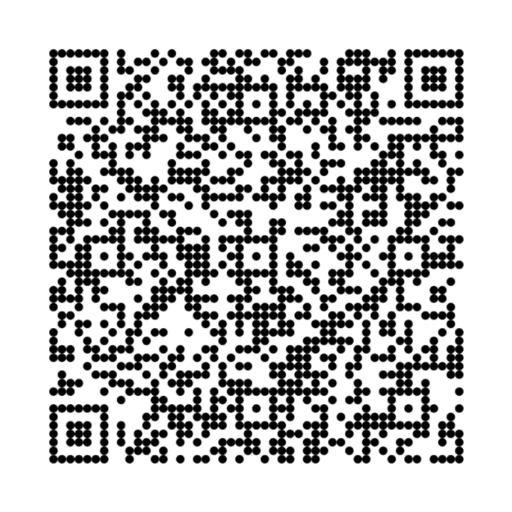

# RedMagic Monitor Control · 红魔显示器

[简体中文](README.md) · **English**

Control the REDMAGIC GM001J 4K Standard Edition from the macOS menu bar or Windows system tray. Switch between Type-C, DP, HDMI 1, and HDMI 2, or adjust brightness, contrast, and the volume of headphones connected to the monitor’s 3.5 mm jack.

Version 1.0.0 of the macOS and Windows apps follows the system language. Both support Simplified Chinese, Traditional Chinese, English, Japanese, Korean, Spanish, Russian, French, German, and Portuguese.

## Download and run

- **macOS (Apple Silicon, macOS 14 or later).** Open the DMG, drag the app to Applications, then open it from there. Click the monitor icon in the macOS menu bar to open the control panel. [Download the macOS 1.0.0 DMG](https://github.com/WeeTom/redmagic-monitor-control/releases/download/v1.0.0/RedMagicMonitor-1.0.0-macOS-arm64.dmg)
- **Windows x64.** Extract the ZIP to a folder where you plan to keep it, then double-click `RedMagicMonitor.exe`. Click the monitor icon next to the taskbar clock to open the panel. If it is hidden, click the up arrow (⌃) in the system tray. [Download the Windows 1.0.0 ZIP](https://github.com/WeeTom/redmagic-monitor-control/releases/download/v1.0.0/RedMagicMonitor-1.0.0-windows-x64.zip)

**First launch.** The macOS app has no Developer ID signature or Apple notarization. If macOS blocks it, try opening the app from Applications once. Then open **System Settings → Privacy & Security**, click **Open Anyway** next to the app, and confirm. If Windows SmartScreen shows a warning, verify that the file came from the release page above. If the option is available, choose **More info → Run anyway**.

**First connection on macOS and Windows.** Connect the video cable and open the app. It finds your GM001J automatically and remembers it for future launches. Existing bindings carry over when you upgrade.

- **DDC.** The first time you open the DDC page, the app reads the EDID of connected displays to identify the GM001J. If it finds one GM001J with a unique serial number, it binds automatically. If it finds several, select your monitor’s serial number from the list.
- **Bluetooth.** Enable Bluetooth in the monitor’s on-screen menu, then open the app’s Bluetooth page. Allow Bluetooth access if your system prompts you. The app searches for nearby GM001J monitors and checks their identity. A single verified monitor binds automatically. If several appear, use the address to select the same physical monitor you selected for DDC.
- **If no monitor appears,** check the video cable or the monitor’s Bluetooth setting. On Windows, DDC also requires an active display output. Return to the relevant page and search again on macOS or click refresh on Windows.
- **To replace a bound monitor,** right-click the macOS menu bar icon and choose **Choose a monitor to control**, or click **GM001J 4K ▾** on the Windows control page.

## Donations

If this tool helps you, you can support its development by scanning a QR code below. Click a code to enlarge it, or scan the same codes on the app’s donation page.

| Venmo | Alipay | WeChat Pay |
| :---: | :---: | :---: |
| <a href="assets/donation/qr/venmo.png"></a> | <a href="assets/donation/qr/alipay.png"></a> | <a href="assets/donation/qr/wechat-pay.png"></a> |
| @weetom | ¥6.66 | ¥6.66 |

## macOS quick start

If you installed the DMG, open the app from Applications. To build it yourself, install Python 3 and the Xcode Command Line Tools, then run these commands from the repository root.

```sh
python3 build.py
open "build/红魔显示器.app"
```

Click the monitor icon in the menu bar to open the panel. You can enable launch at login at the bottom. For regular use, you can move the built app to Applications.

### Export an input shortcut app

On either control page, open the shortcut export menu in the input section, choose Type-C, DP, HDMI 1, or HDMI 2, and select a save location. Finder selects the new `.app`. To use it in Apple Shortcuts, add an **Open App** action and choose the exported app for DP, for example. Running the shortcut switches the monitor to DP.

An exported app can use DDC and Bluetooth even after you quit the menu bar app. If both connections were bound at export, the shortcut first tries DDC and exits as soon as it reads back the requested input. If DDC cannot send the command, the shortcut verifies the monitor’s identity over Bluetooth and selects the requested input. If DDC sent the command but lost readback after the switch, the shortcut checks the monitor’s menu over Bluetooth. It sends another switch command only if the menu still shows a different input. The Bluetooth reading reflects the menu selection, which can retain its previous value after a successful DDC switch.

When you export, the app checks for a second connection automatically. If it can verify both connections, it includes both in the shortcut. If only one is available, you can export with that connection. If there are several monitors, select yours on both control pages and export again. macOS may ask for Bluetooth access the first time a shortcut uses it.

## DDC and Bluetooth controls

- **DDC** supports all four inputs, brightness, contrast, and headphone volume. Each slider ranges from 0 to 100 and supports one-step adjustments. Restoring defaults sets brightness and contrast to 50 and leaves the volume at its current setting. Volume uses the monitor’s vendor-specific DDC command C8. On stock firmware, setting the volume to 0 showed 0 in the on-screen menu and muted the 3.5 mm headphone output.
- **Bluetooth** supports all four inputs, eight picture modes, HDR, and ambient lighting. The lighting controls offer seven effects, three brightness levels, and a color selector. The multicolor flow effect also lets you set the front and rear colors independently. The app reuses the connection across operations and disconnects after five minutes of inactivity. You can disconnect manually on the Bluetooth page before using the mobile app.
- **Input selection and the on-screen menu.** DDC reports the active video input. Bluetooth reports the selection saved in the monitor’s menu. A GM001J displaying DP still reported Type-C over Bluetooth. After DP was selected again over Bluetooth, two separate queries and the on-screen menu all confirmed DP. When you select an input on the DDC page, the app tries to synchronize the menu if its Bluetooth connection is bound and access is authorized. If you switch inputs using another tool, you can click the active input on the Bluetooth page even if its button is already selected.
- **USB and HDMI.** In a two-computer setup connected over Type-C and DP, switching inputs over Bluetooth also switched the USB upstream connection for the keyboard and mouse. Video output was confirmed after switching to HDMI 2 over Bluetooth. HDMI 1 video output and DDC switching on both HDMI ports still need hardware verification.
- **Status and readback.** The app opens on the DDC page on first use, then remembers the last page you selected. When you change pages, the app shows cached values first and connects to read current values as needed. Dragging a slider sends the latest target value. The app verifies each write with a separate query. If readback fails, the panel keeps the last confirmed value. Click refresh to read it again. Automatic checks at startup and after wake are read-only.

## Windows quick start

To upgrade, quit the existing tray app and replace its EXE in the same location with the one from the 1.0.0 ZIP. The new version reuses your device bindings and existing shortcuts. [Download and run](#download-and-run)

On either control page, choose the shortcut export option in the input section, select an input, and save the `.lnk` file. Open the shortcut to switch inputs. It starts the tray app if needed. Shortcuts for all four inputs try DDC first and use the bound Bluetooth connection when needed. Each shortcut points to the EXE you exported it from. If you move the EXE, export the shortcut again.

To build the app yourself, download and extract the source archive. [Download the 1.0.0 source ZIP](https://github.com/WeeTom/redmagic-monitor-control/archive/refs/tags/v1.0.0.zip)

Alternatively, install the .NET 10 SDK, then clone the repository and start the tray app from PowerShell.

```powershell
git clone --branch v1.0.0 https://github.com/WeeTom/redmagic-monitor-control.git
cd redmagic-monitor-control
dotnet run --project .\windows\RedMagicMonitor.csproj -c Release -- --show
```

The Windows guide explains how to choose another monitor, where existing bindings are stored, and how to build a self-contained, single-file EXE. [Windows build and configuration guide (Chinese)](windows/README.md) · [Device protocol profile](device-profile.json) · [Bluetooth setup notes (Chinese)](hardware/README.txt)

You can build and run the protocol tests separately in Visual Studio Developer PowerShell with a version of MSVC that supports C11.

```powershell
cl /nologo /std:c11 core\GMProtocol.c tests\protocol_test.c /Fe:protocol-test.exe
.\protocol-test.exe
```

## Offline tests on macOS

After running `python3 build.py`, run the following commands from the repository root. The protocol tests and app self-test run offline.

```sh
clang -std=c11 -Wall -Wextra -Werror -fsanitize=address,undefined core/GMProtocol.c tests/protocol_test.c -o build/protocol-test
./build/protocol-test
"./build/红魔显示器.app/Contents/MacOS/RedMagicDisplay" --self-test
swiftc macos/Features.swift macos/InputShortcutExporter.swift tests/input_shortcut_export.swift -o build/test-shortcut-export
./build/test-shortcut-export
```

Use `--preview /absolute/path.png` to render a demo of the interface. Add `--preview-bluetooth` for the Bluetooth page or `--preview-donation` for the donation page. After quitting the menu bar app, use `--probe` to read DDC status or `--probe-keepalive` to check whether two rounds of Bluetooth queries reuse the same connection. Logs are stored in `~/Library/Logs/RedMagicDisplay/`.

## License

This project uses the MIT License. DDC communication on Apple Silicon uses waydabber’s m1ddc. The repository includes the upstream copyright notice and a record of local changes. [Project license](LICENSE) · [m1ddc license](third_party/m1ddc/LICENSE) · [Local changes to m1ddc](third_party/m1ddc/LOCAL-CHANGES.txt)
